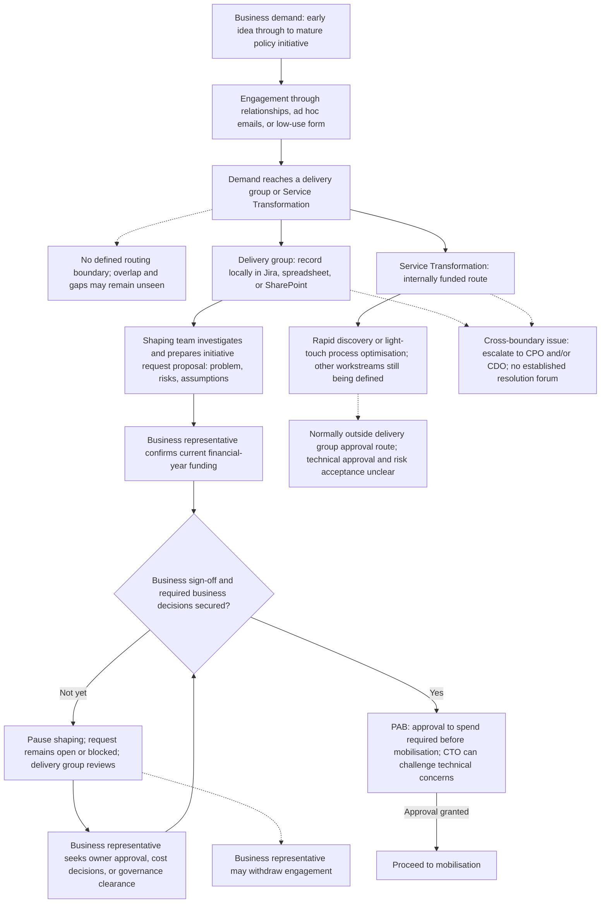

# Demand and shaping

Based on sponsor-led discovery as at 12 November 2026. Current process for validation, not an approved operating model. Delivery group details primarily reflect the sponsor's group; other groups vary.

Solid arrows show reported progression. Dotted lines show context, exceptions, or relationships whose detailed process is not established. Decision boxes do not imply consistently enforced gates.

Business case approval is normally expected, but its exact timing across routes is unconfirmed. Early DDTS involvement before the outline business case is a preference, not an established universal step. PAB refusal, deferral, and resubmission arrangements have not been described.

[Discovery baseline](../README.md) | [All process flows](../docs/current-process.md)

