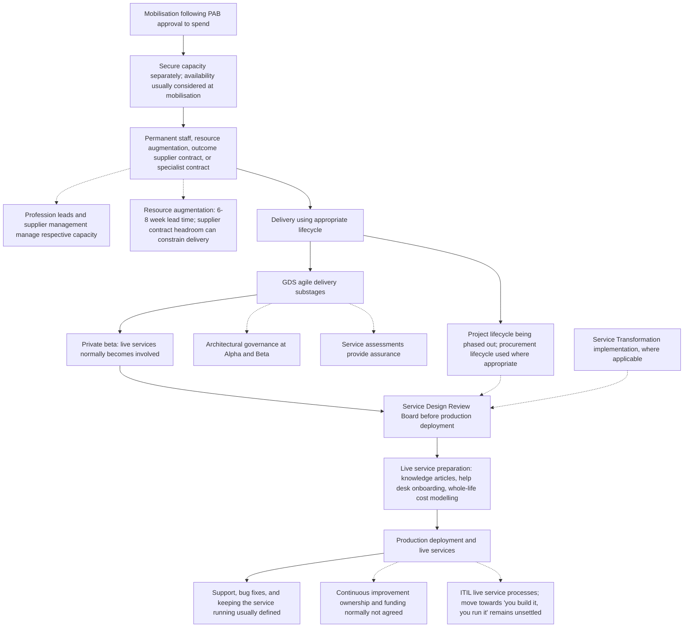

# Mobilisation, delivery, and live services

Based on sponsor-led discovery as at 12 November 2026. Current process for validation, not an approved operating model. Delivery group details primarily reflect the sponsor's group; other groups vary.

Solid arrows show reported progression. Dotted lines show context, exceptions, or relationships whose detailed process is not established. Decision boxes do not imply consistently enforced gates.

The Service Design Review Board was described as required before go-live. The precise Service Transformation handoff and the mapping of non-agile routes to that review need validation; dotted connectors do not assert a confirmed sequence. Review outcomes, formal acceptance criteria, and the exact sequencing of preparation activities have not been detailed.

[Discovery baseline](../README.md) | [All process flows](../docs/current-process.md)

