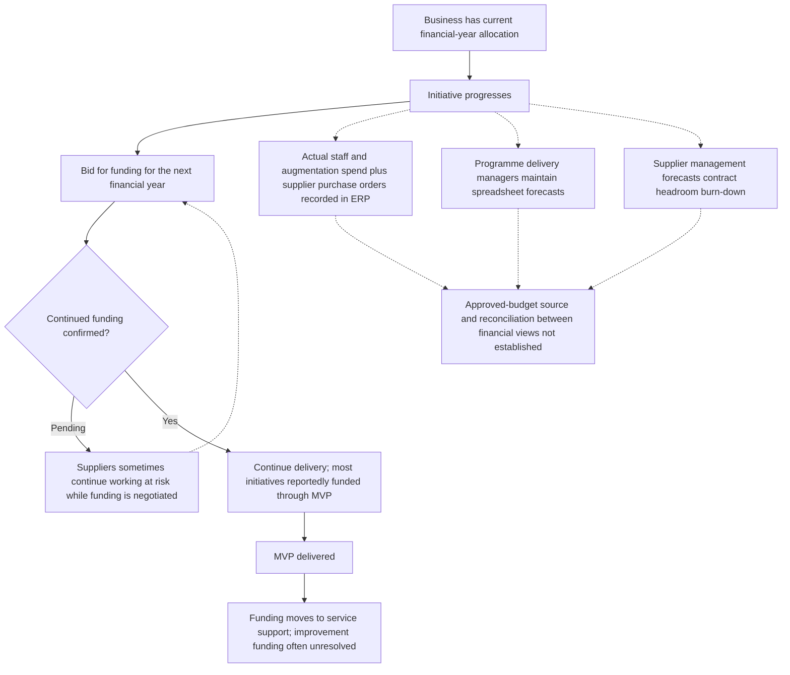

# Annual funding and financial oversight

Based on sponsor-led discovery as at 12 November 2026. Current process for validation, not an approved operating model. Delivery group details primarily reflect the sponsor's group; other groups vary.

Solid arrows show reported progression. Dotted lines show context, exceptions, or relationships whose detailed process is not established. Decision boxes do not imply consistently enforced gates.

This runs alongside the lifecycle, rather than being a single stage in it.

The process when continued funding is refused has not been established. Working at risk is a reported practice, not a recommendation or confirmation of commercial authorisation.

[Discovery baseline](../README.md) | [All process flows](../docs/current-process.md)

