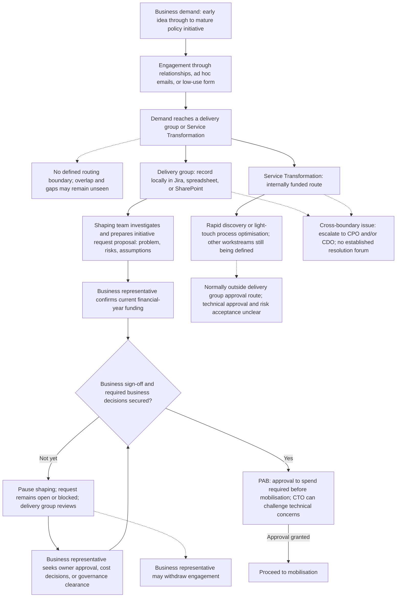
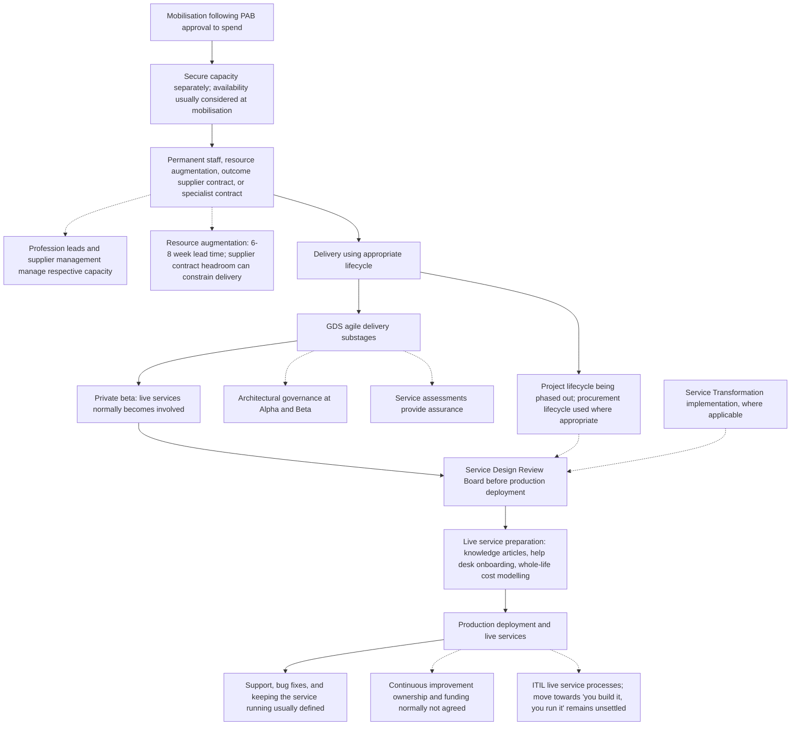
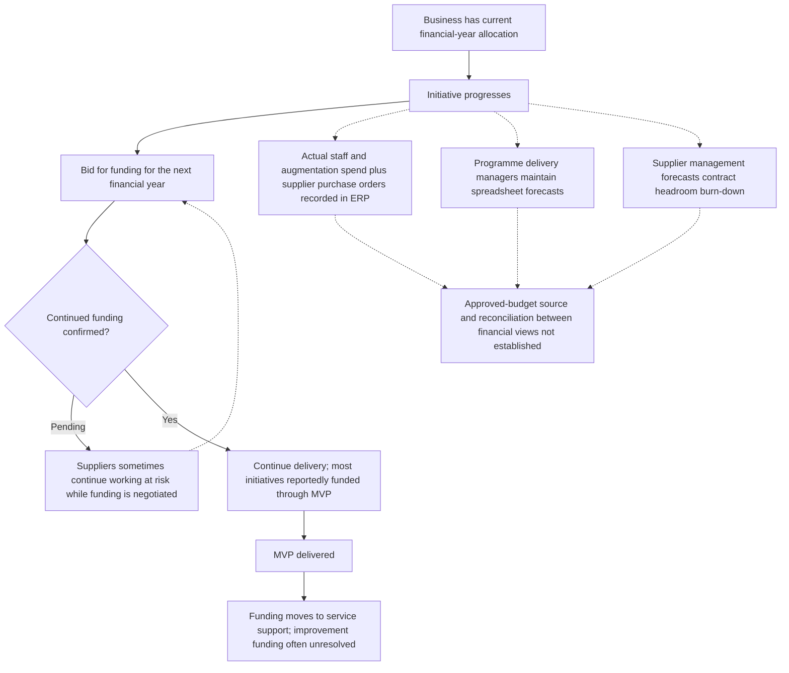

# DDTS current process flow

Based on sponsor-led discovery as at 12 November 2026. This is a description for validation, not an approved process or a future-state design. The delivery group detail primarily reflects the sponsor's group; other groups vary.

Solid arrows show the reported progression. Dotted lines show context, exceptions, or relationships whose detailed process is not established. A decision box does not imply that a formal, consistently enforced gate exists.

## Demand and shaping

Business case approval is normally expected, but its exact timing across routes is unconfirmed. Early DDTS involvement before the outline business case is a preference, not an established universal step. PAB refusal, deferral, and resubmission arrangements have not been described.

## Mobilisation, delivery, and live services

The Service Design Review Board was described as required before go-live. The precise Service Transformation handoff and the mapping of non-agile routes to that review need validation; dotted connectors do not assert a confirmed sequence. Review outcomes, formal acceptance criteria, and the exact sequencing of preparation activities have not been detailed.

## Annual funding and financial oversight

This runs alongside the lifecycle, rather than being a single stage in it.

The process when continued funding is refused has not been established. Working at risk is a reported practice, not a recommendation or confirmation of commercial authorisation.

## Main gaps exposed by the flow

- No consistent routing or shared check for overlapping demand across delivery groups and Service Transformation.
- Cross-boundary decision authority and escalation are not formalised below CPO/CDO level.
- Business authority, funding decisions, and governance can leave shaping blocked.
- Capacity and contract headroom are considered late and separately from approvals.
- Service Transformation technical approval and risk acceptance are unclear.
- Live service engagement normally begins in private beta; continuous improvement responsibility and funding remain unsettled.
- Blocked and closed work does not have a visibly consistent process for updating portfolio and capacity commitments.
- Strategic alignment and rejection of unjustified demand are proposed changes, not steps in the current flow.

See the [discovery baseline](../README.md) for evidence, proposed changes, success criteria, and remaining questions.
